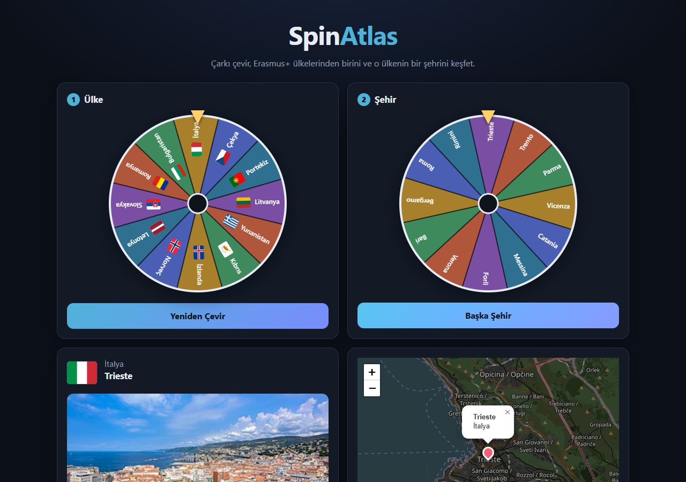
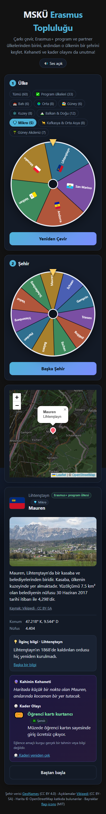

# 🎡 MSKÜ Erasmus Topluluğu

**Çarkı çevir, rastgele bir Erasmus+ ülkesi ve o ülkeden bir şehir keşfet; ilginç bilgiler öğren, kehanetini ve kader olayını gör.**

### 👉 [Canlı demo: nevzatius.github.io/spinatlas](https://nevzatius.github.io/spinatlas/)



Hesap, sunucu veya veritabanı gerekmez; tarayıcıda çalışan, tamamen statik bir web uygulamasıdır.

## Nasıl kullanılır?

1. **Bölgeni seç (isteğe bağlı).** Çarkın üstündeki sekmelerle ülkeleri daraltabilirsin: Tümü, Program ülkeleri veya bir bölge (Batı, Orta, Güney, Kuzey, Balkan & Doğu, Mikro, Kafkasya & Orta Asya, Güney Akdeniz).
2. **Ülke çarkını çevir.** "Çarkı Çevir" butonuna bas; 60 Erasmus+ ülkesinden biri rastgele seçilir. Harita ülkeye yakınlaşır, kartta ülkenin bir **ilginç bilgisi** belirir.
3. **Şehir çarkını çevir.** Ülke seçilince ikinci çark açılır; yalnızca o ülkenin şehirlerini içerir. Şehir seçilince harita şehre yakınlaşır ve işaretçi koyar.
4. **Şehri ve kaderini keşfet.** Bilgi kartında bayrak, ülkenin Erasmus+ durumu (program/partner), Vikipedi'den kısa açıklama, fotoğraf, koordinat, nüfus, ülke hakkında ilginç bilgi, **🔮 Kahinin Kehaneti** ve rastgele bir **🎲 Kader Olayı** görünür. "Kaderi yeniden çek" yeni bir kehanet ve olay getirir.
5. **Tekrar dene.** "Yeniden Çevir" yeni bir ülke, "Başka Şehir" aynı ülkeden yeni bir şehir seçer. "Baştan başla" her şeyi sıfırlar. Çark sesini üstteki düğmeyle kapatabilirsin.

Harita yakınlaştırılabilir, uzaklaştırılabilir ve sürüklenebilir. Arayüz koyu temalıdır ve mobilde de çalışır.

| Mobil |
| --- |
|  |

## Kapsanan ülkeler

60 ülke: 33 **Erasmus+ program ülkesi** (AB-27 + Türkiye, Norveç, İzlanda, Lihtenştayn, Kuzey Makedonya, Sırbistan) ve 27 **partner ülke** (Birleşik Krallık, İsviçre, Arnavutluk, Bosna-Hersek, Kosova, Karadağ, Ukrayna, Moldova, Ermenistan, Azerbaycan, Gürcistan, Andorra, Monako, San Marino, Vatikan, Fas, Cezayir, Tunus, Mısır, Ürdün, Lübnan, İsrail, Kazakistan, Kırgızistan, Tacikistan, Türkmenistan, Özbekistan). Her ülke için nüfusa göre en büyük en fazla 40 şehir çarkta yer alır (toplam 2142 şehir). Liste `src/data/countries.json` içinde düzenlenebilir.

## Nasıl çalışır?

- **Adil rastgelelik:** Kazanan, ülkenin tüm şehir listesinden `crypto.getRandomValues` ile seçilir. Çark seçili filtredeki tüm ülkeleri (en fazla 60) ve ülkenin tüm şehirlerini (en fazla 40) gösterir; dilim yazıları ve bayraklar dilim sayısına göre küçülür. Seçim çarktan bağımsız yapıldığı için dilim sayısı adilliği etkilemez.
- **Doğru bilgi:** Şehir açıklaması Türkçe Vikipedi'den (yoksa İngilizce) gelir. Sayfa belirsizleştirme sayfası değilse ve koordinatı şehre ≤ 50 km yakınsa kullanılır. Güvenilir kaynak bulunamazsa metin uydurulmaz; yalnızca doğrulanmış konum ve nüfus gösterilir.
- **İlginç bilgiler:** Ülke başına 2-3 bilgi elle yazılmıştır (`src/data/facts.ts`); amaç yalnızca doğrulanabilir bilgiler vermektir. Hatalı bir bilgi görürsen düzeltme gönderebilirsin.
- **Kehanet ve kader olayı:** `src/data/fate.ts` içindeki eğlence amaçlı kurgudur ve kartta öyle etiketlenir. Bazı olaylar yalnızca belirli bölgelerde çıkar (ör. kar fırtınası yalnızca Kuzey'de). Türkçe ek hatalarını önlemek için metinler şehir adına ek getirmez.
- **Veri:** Şehirler ve koordinatlar [GeoNames](https://www.geonames.org/)'ten, Türkçe adlar ve Vikipedi başlıkları Wikidata'dan alınır ve `src/data/cities.json` dosyasına yazılır. Çalışma zamanında yalnızca Vikipedi (özet, fotoğraf) ve harita karoları için ağ isteği yapılır.
- **Teknoloji:** Vite + TypeScript (framework yok), Canvas çarklar, Leaflet + OpenStreetMap. Tek çalışma zamanı bağımlılığı Leaflet'tir.

## Geliştirme

```bash
npm install
npm run dev      # geliştirme sunucusu
npm test         # birim testleri
npm run build    # dist/ üretir
npm run data     # şehir verisini yeniden üretir (GeoNames + Wikidata)
```

## GitHub Pages ile yayınlama

`main` dalına push edildiğinde `.github/workflows/deploy.yml` testleri çalıştırıp siteyi yayınlar. Fork'larda **Settings → Pages → Source: GitHub Actions** seçilmelidir. `vite.config.ts` içinde `base: './'` olduğu için sitenin herhangi bir alt yolunda çalışır.

## Atıflar

- Şehir verisi: [GeoNames](https://www.geonames.org/), CC BY 4.0
- Açıklamalar ve görseller: [Vikipedi](https://www.wikipedia.org/), CC BY-SA (kartta kaynak bağlantısı verilir; fotoğrafların kendi lisansları ilgili Vikipedi/Commons sayfasındadır)
- Harita: © [OpenStreetMap](https://www.openstreetmap.org/copyright) katkıda bulunanlar, [Leaflet](https://leafletjs.com/)
- Bayraklar: [flag-icons](https://github.com/lipis/flag-icons), MIT

## Lisans

[MIT](LICENSE)
